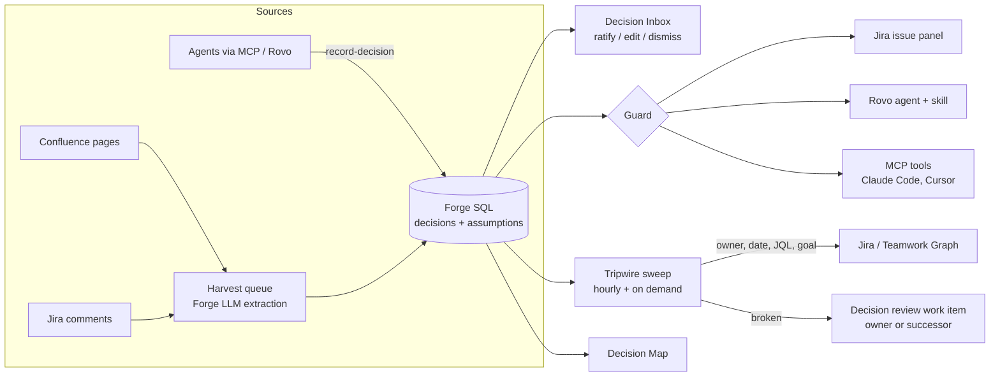

# Precedent

**Your team's case law, enforced for people and AI agents.**

Teams make hundreds of decisions a year: which database the ledger uses, which HTTP client every service calls, what must never be logged. The reasons live in old Confluence pages and Jira threads, so new teammates re-argue settled questions. AI coding agents never knew the decisions in the first place, so they happily add the library the team banned last spring. And when the facts a decision rested on change, nobody notices.

Precedent is an Atlassian Forge app that turns those decisions into living, enforced context.

| | What it does | Where it runs |
|---|---|---|
| **Collect** | Finds decisions in Confluence pages and Jira comments, extracts the statement, rationale, owner, scope and the **assumptions** behind each, and files them for one-click ratification. | Triggers + queue + Forge LLMs, Decision Inbox |
| **Guard** | Checks new work against ratified decisions and explains conflicts, with a suggested way to respect them. | Jira issue panel, Rovo agent, `precedent-check` Rovo skill, MCP tools for Claude Code and Cursor |
| **Tripwires** | Watches each assumption (owner still here, contract dates, incident counts via JQL, goal status). When one breaks, opens a "Decision review" for the owner, or for a successor from their Teamwork Graph team. | Hourly scheduled trigger, "Run checks now" |
| **Map** | Health of every decision over time, what tripped, and an audit trail of which people and agents checked what. | Jira global page |

## How it uses the Atlassian platform

- **Rovo agent** (`rovo:agent`) answers "why do we…" questions with sources, checks plans and records decisions.
- **Rovo actions** (`action` × 6) and a reusable **Rovo skill** (`rovo:skill`, `skills/precedent-check/SKILL.md`) that any Forge agent can use.
- **MCP server** (`rovo:mcp`) exposes `search-decisions`, `check-plan`, `record-decision` and `get-issue-context` to external coding agents, so Claude Code checks the team's decisions before it writes code and records the ones it makes.
- **Teamwork Graph** (Cypher queries via `requestTeamworkGraph`): team membership for successor suggestions and owner-by-team views, goal updates for goal-status tripwires.
- **Forge LLMs** for extraction and conflict judgment, metered against an admin-set monthly budget, with a no-AI fallback. No data leaves Atlassian.
- **Forge SQL** for decisions, assumptions, sources, tripwire events and the check log; **KVS** for settings and usage; **queues**, **product triggers** and **scheduled triggers** for background work.
- **UI Kit** issue panel and global page.

## Architecture



The domain logic (`src/domain`, `src/guard`, `src/tripwires`, `src/harvest/pipeline.ts`) is pure TypeScript behind small ports, so it's unit-tested without Forge. Forge-specific code lives in `src/integrations`, `src/db`, `src/handlers` and `src/resolvers`.

```
src/
  domain/        decision model, tags, health, store and review ports
  ai/            Forge LLM client, budget meter, prompts, JSON validation
  db/            Forge SQL schema, migrations and the decision store
  harvest/       collectors, extraction pipeline, queue jobs
  guard/         relevance ranking and conflict judgment
  tripwires/     watchers, engine, successor suggestion, Teamwork Graph lookups
  integrations/  Jira, Confluence, Teamwork Graph, ADF and storage-format helpers
  services/      operations shared by the UI, Rovo actions and MCP tools
  handlers/      Forge triggers, consumers and actions
  resolvers/     UI Kit resolvers
  frontend/      issue panel and global page (UI Kit)
  demo/          Acme Pay demo company
skills/precedent-check/SKILL.md
test/            vitest specs
```

## Develop

You need Node 22.23.4 or newer and the Forge CLI.

```bash
npm install -g @forge/cli
npm install
npm run check        # typecheck + unit tests
```

Deploy to your development site:

```bash
forge login
forge register       # first time only; sets the app id in manifest.yml
forge deploy -e development
forge install -e development --site <your-site>.atlassian.net --product jira
forge install -e development --site <your-site>.atlassian.net --product confluence
forge tunnel         # optional: live backend while you test
```

Rovo is missing on some free developer sites; `forge site provision` creates a 90-day demo site with Rovo enabled. Forge LLM usage is billed to the developer account, so add a payment method under your Forge developer settings first.

## Try it

See [docs/INSTALL_FOR_JUDGES.md](docs/INSTALL_FOR_JUDGES.md): load the Acme Pay demo company from **Apps → Precedent → Settings**, then follow the five-minute tour.

## Docs

- [Install and tour](docs/INSTALL_FOR_JUDGES.md)
- [Demo video script](docs/DEMO_SCRIPT.md)
- [Marketplace listing draft](docs/MARKETPLACE.md)
- [Privacy policy](docs/PRIVACY.md)
- [Product and build plan](docs/PLAN.md)
